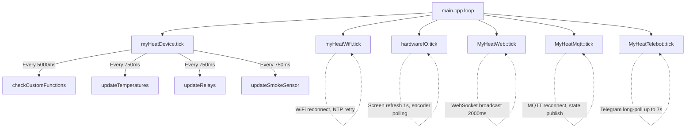
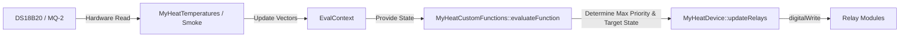

# MyHeat IoT Project Documentation

## 1. PROJECT IDENTITY
- **Name:** MyHeat
- **Author:** Tommy4chan
- **Platform:** ESP32 (NodeMCU-32S), Arduino framework via PlatformIO
- **Language:** Ukrainian UI throughout (both web and OLED)
- **License:** MIT
- **Repo:** https://github.com/Tommy4chan/MyHeat

## 2. HARDWARE SETUP
The project is built for the ESP32 platform and utilizes specific peripherals for its smart heating control functions.
- **Microcontroller:** ESP32 NodeMCU-32S (240MHz, 320KB RAM, 4MB Flash)
- **Temperature Sensors:** DS18B20 (OneWire bus on GPIO 23). Max resolution used: 11-bit. Fail-safe thresholds configured to -127.0 (TEMPERATURE_ERROR).
- **Relay Modules:** Controlled via configurable GPIOs. Relays support Active-High and Active-Low configurations per relay (default is usually active-low for standard Arduino modules).
- **Smoke Sensor:** MQ-2 analog gas/smoke sensor (GPIO 35), requires a 30s preheat time. Analog reads range from 0-4095. Value initialized to `ANALOG_INITIAL_VALUE` (-1) during startup.
- **Display:** SH1106 or SSD1306 128x64 OLED display connected via I2C (SDA: GPIO 33, SCL: GPIO 25).
- **Input:** Rotary encoder with a push button (A: GPIO 32, B: GPIO 34, Btn: GPIO 35). Note that GPIO 35 is shared with the smoke sensor in some configurations, requiring careful pin assignment in production.

### Custom Partition Scheme (`esp32_custom_partition_4mb.csv`)
To accommodate the large React web UI and OTA updates, a custom 4MB partition scheme is used:
- `nvs`: 20KB (0x9000)
- `otadata`: 8KB (0xe000)
- `app0`: 1.8MB (0x10000)
- `app1`: 1.8MB (0x1d0000)
- `spiffs` (LittleFS): 256KB (0x390000)
- `coredump`: 64KB (0x3f0000)

## 3. PROJECT STRUCTURE
The codebase is divided into a C++ firmware backend and a React JavaScript frontend.

### Firmware (C++)
- `src/main.cpp` - Application entry point and main loop orchestration.
- `lib/MyHeatDevice/` - Core logic containing 13 files. Handles custom function evaluation, relays, temperatures, and sensors.
- `lib/MyHeatWeb/` - `ESPAsyncWebServer` setup and WebSocket API handlers mapping JSON actions to C++ methods (12 files).
- `lib/MyHeatWifi/` - WiFi Station/Access Point management, NTP sync, mDNS (myheat.local).
- `lib/MyHeatTelebot/` - Telegram bot integration using `FastBot2` (10 files). Long-polling design.
- `lib/MyHeatMqtt/` - MQTT communication and Home Assistant auto-discovery via `PubSubClient`. Buffer is extended to 1024 bytes.
- `lib/MyHeatAlerts/` - Multi-channel alert dispatch system pushing events to Telegram and WebSockets.
- `lib/MyHeatSave/` - LittleFS JSON persistence wrappers via `MyHeatSaveInterface`.
- `lib/MyHeatUtils/` - Shared utilities, enum translations, string formatting.
- `lib/MyHeatHardwareIO/` - Local interface logic for the OLED screen (`U8g2`) and rotary encoder (`EncButton`).
- `configs/` - Deployment configurations (`platformio-dev.ini`, `platformio-garage.ini`, `platformio-debug-lviv.ini`).

### Frontend (JavaScript/React)
- `web/` - React 19, Vite 6, Tailwind CSS 3.4, and Zustand 5. Output is built directly to `../data/` for LittleFS upload. StrictMode is disabled to avoid WebSocket double-instantiation.

## 4. SYSTEM ARCHITECTURE

### 4.1 Main Loop Architecture
The system operates on a non-blocking loop structure in `main.cpp`, polling each subsystem via `tick()` methods.
*Note: The system defers entering the full main loop until WiFi connects or a `SYSTEM_LOAD_TIMEOUT` (30s) expires. NTP must sync before the Telegram bot is started.*

### 4.2 Data Flow
Sensor readings flow into central vectors (`std::vector<float> temperatures`), which are packaged into an `EvalContext`. This context is evaluated by the custom function engine (`checkCustomFunctions`) to determine relay states based on dynamic rule trees.

### 4.3 Singleton and Namespace Patterns
- **Singletons (`getInstance()`):** `MyHeatDevice`, `MyHeatWifi`, `MyHeatHardwareIO`. Used for physical hardware constraints where only one instance can safely interact with the I2C/OneWire bus or WiFi radio.
- **Static Namespaces:** `MyHeatWeb`, `MyHeatTelebot`, `MyHeatMqtt`, `MyHeatAlerts`. Used for stateless protocol handlers where object instantiation adds unnecessary overhead.

## 5. SUBSYSTEM DEEP DIVES

### 5.1 Custom Functions Engine (Core Automation)
The absolute core of the MyHeat system. This engine allows users to build complex logic trees (Abstract Syntax Trees) directly in the UI, which are parsed and evaluated safely in C++.

#### Core Data Structures (`MyHeatCustomFunction.h`)
- **`ConditionType` Enum:** `COND_AND` (0), `COND_OR` (1), `COND_NOT` (2), `COND_CMP` (3 - Comparison).
- **`CompareOp` Enum:** `OP_EQ` (0), `OP_NEQ` (1), `OP_LT` (2), `OP_GT` (3), `OP_LTE` (4), `OP_GTE` (5), `OP_RANGE` (6), `OP_AVAILABLE` (7), `OP_UNAVAILABLE` (8).
- **`SourceType` Enum:** `SRC_TEMP` (0), `SRC_RELAY` (1), `SRC_SMOKE` (2), `SRC_ANALOG` (3), `SRC_SYSTEM` (4).
- **`ActionType` Enum:** `ACT_SET_RELAY` (0), `ACT_SET_RELAY_TIMER` (1).

- **`ConditionNode` (44 bytes)**:
  - `ConditionType type;` 
  - `SourceType source1; uint8_t index1;` (LHS Source)
  - `CompareOp op;`
  - `bool isValueSource;` (Is RHS a constant or another source?)
  - `SourceType source2; uint8_t index2;` (RHS Source, if `isValueSource == true`)
  - `uint8_t childCount; uint8_t childStart;` (For `AND`/`OR`/`NOT` nodes traversing the flat array)
  - `int8_t lastResult;` (-1=never evaluated, 0=false, 1=true)
  - `float delta1; float delta2_or_value; float hysteresis;` (Math applied during evaluation)

- **`ActionNode` (16 bytes)**:
  - `ActionType type;`
  - `uint8_t targetIndex;` (Relay Index)
  - `uint8_t value;` (0=OFF, 1=ON)
  - `uint32_t duration;` (Timer duration in seconds)
  - `uint8_t timerType;` (0=Restart, 1=Pulse, 2=Cyclic)
  - Runtime State Variables: `isTimerRunning`, `prevConditionState`, `timerStartMillis` (Automatically managed by `updateRelays()`).

#### Evaluation Algorithm (`MyHeatCustomFunctions.cpp`)
1. **Context Initialization:** `checkCustomFunctions()` creates an `EvalContext` holding references to current temperatures, relay states, and smoke sensor values.
2. **Recursive Evaluation (`evaluateNode`):** For each enabled function, the engine starts at the root node (Index 0).
   - If `COND_AND`, short-circuit returns `false` on the first `false` child.
   - If `COND_OR`, short-circuit returns `true` on the first `true` child.
   - If `COND_CMP`, control is passed to `evaluateCompare()`.
3. **Comparison & Hysteresis (`evaluateCompare`):**
   - Resolves `LHS` and `RHS` values using `getSensorValue()`.
   - **Fail-safe mechanism:** If any required sensor returns `NAN` (e.g., disconnected temp sensor), the comparison immediately evaluates to `false`. This prevents heaters from becoming stuck ON due to broken probes.
   - **Directional Hysteresis:** Hysteresis acts as a deadband. 
     - For `OP_LT` (<): If previously true, it stays true until `lhs >= rhs + hyst`. If previously false, it requires `lhs < rhs - hyst` to become true.
     - For `OP_GT` (>): If previously true, it stays true until `lhs <= rhs - hyst`. If previously false, it requires `lhs > rhs + hyst` to become true.

#### Timer Modes (`MyHeatDevice::updateRelays`)
The timer system interprets the continuous boolean state (`C`) of a function and converts it to relay timing.
- **Type 0 (Restart / Off-Delay):** 
  - `if (C)` -> Start/Restart Timer, Relay ON.
  - `if (!C)` -> Keep Relay ON until `millis() - start < Duration`. Then Relay OFF.
- **Type 1 (Pulse / One-Shot):** 
  - Triggers on Rising Edge: `if (C && !prevConditionState)` -> Start Timer, Relay ON.
  - Keeps Relay ON for `Duration` regardless of `C` dropping to false. Cannot be re-triggered until the timer expires.
- **Type 2 (Cyclic):** 
  - Starts when `C` is true.
  - ON Phase: `elapsed < Duration` -> Relay ON.
  - OFF Phase: `elapsed >= Duration && elapsed < Duration * 2` -> Relay OFF.
  - Loop Phase: `elapsed >= Duration * 2` -> Restart cycle.
  - Abort condition: `if (!C)` during the OFF phase, the cycle aborts completely.

#### Priority Conflict Resolution
- A single relay might be controlled by multiple functions.
- Every function has a `priority` (uint8_t, higher = more important).
- During `updateRelays()`, all active actions are gathered. For each relay, the engine tracks a `RelayTarget` struct (`isActive`, `maxPriority`).
- A function's requested state is only applied if its priority is `>` the currently registered `maxPriority` for that relay.
- If in AUTO mode and NO functions claim a relay, the system defaults it to OFF.

#### Tree Serialization Protocol (Flat Array)
To transport the complex AST over JSON via WebSockets efficiently, the tree is flattened.
- JSON structure: `conditions: [{t: 3, src: 0, si: 0, d1: 0, op: 2, ivs: false, v: 25, hyst: 0.5}, {t: 0, cs: 1, cc: 2}]`
- A logical node (`t: 0` for AND) points to its children using `cs` (Child Start Index) and `cc` (Child Count).
- The array is built using Breadth-First Search (BFS) in JS (`flattenConditionTree`) and parsed similarly in C++.

### 5.2 Temperature System (`MyHeatTemperatures.cpp`)
- Built on `DallasTemperature` and `OneWire`.
- **Fail-Once Polling (750ms interval):** DS18B20 reads occasionally fail. The system sets `temperaturesFail[i] = true` on the first failure but retains the last known good value to prevent hysteresis spikes. If a second consecutive read fails, the value is set to `TEMPERATURE_ERROR` (-127.0).
- **Discovery Routine:** `discoverTemperatureSensor()` scans the OneWire bus, verifies device signatures, and skips addresses already saved in `temperatureSensorsAddresses` (stored as `std::array<uint8_t, 8>`).

### 5.3 Alert System (`MyHeatAlerts.h/cpp`)
- Decentralized alert generation. Subsystems push alerts to a central dispatcher via `triggerAlert()`.
- Alerts are state-change based. The system tracks `lastAlertMessages` and only triggers notifications if the string changes (to avoid spamming Telegram every 750ms).
- `EvalContext.discoveredAlert` acts as a side-channel during function evaluation, allowing `getSensorValue()` to flag if it encounters a bad sensor index (`FA_BAD_TEMPERATURE_NUMBER`) or broken hardware (`FA_BAD_TEMPERATURE`).

### 5.4 WebSocket API (`MyHeatWeb.cpp`)
- Runs on `ESPAsyncWebServer` at `/ws`.
- Payload Schema: `{messageType: string, payload: object}`.
- Response Schema: `{messageType: string, payload: object, status: {type: "success"|"error", message: string}}`.
- Background Loop: `sendRepeatableDataToClients()` broadcasts `temperaturesData`, `relaysData`, and `functionsData` to all connected clients every 2000ms.
- Mutation Handler: Receiving any `setX` or `delX` command triggers `MyHeatDevice::manualTick()`, instantly evaluating Custom Functions and updating Relays without waiting for the 5-second main loop timer.
- **WiFi Mitigation:** The ESP32 struggles to handle heavy WebSocket traffic while actively scanning for WiFi networks. When clients are connected via the fallback AP, aggressive WiFi auto-reconnect is temporarily suspended.

### 5.5 Telegram Bot (`MyHeatTelebot.cpp`)
- Powered by `FastBot2`. Requires the ESP32 to establish an SSL connection to Telegram's API.
- **Long-Polling Blocking Behavior:** `bot.tick()` performs a blocking HTTPS request. When no messages are pending, it holds the connection open for up to 7 seconds. This completely halts the `loop()` on Core 1 during this period.
- **User Authentication:** Unregistered users cannot use the bot. They must send a specific `registerPhrase`. Upon matching, their ChatID is saved to LittleFS `/users/<chatId>.json`. Only registered ChatIDs receive Alert Notifications.

### 5.6 Hardware IO (`MyHeatHardwareIO.cpp`)
- Local I2C OLED display utilizing the `U8g2` library.
- Encoder handling via `EncButton` (`eb.tick()`).
- Because Telegram blocks Core 1, the OLED loading animation runs on a FreeRTOS task pinned to Core 0 (`loadingScreenTask`).
- Menu navigation includes: Temperature views, Relay views, Smoke view, Network info, and a QR Code generated dynamically containing the `mDNS` URL.
- Screen timeout functionality (power saving) dynamically shuts off the OLED if no encoder interaction occurs within `screenPowerSaveInterval`.

### 5.7 LittleFS Persistence (`MyHeatSave.h`)
- Abstraction class `MyHeatSave` wraps `ArduinoJson` serialization.
- Configuration separated into tiny, targeted JSON files to avoid RAM exhaustion when parsing.
  - `/wifi.json` - SSID/Passwords, NTP settings.
  - `/relays.json` - Active-High/Low settings, default modes.
  - `/temperatureSensors.json` - Saved OneWire addresses.
  - `/customFunctions.json` - The massive custom functions AST payloads.
  - `/mqtt.json`, `/telebot.json`, `/smokeSensor.json`, `/hardwareIO.json`.
- Whole-device backup and restore is handled via `getAllDeviceSettings` and `setAllDeviceSettings` through WebSockets, packing all JSONs into a master payload.

## 6. WEB FRONTEND ARCHITECTURE

### 6.1 State Management (Zustand 5)
React components rarely hold state. `Zustand` manages central stores:
- **`websocketStore.js`:** Owns the `react-use-websocket` instance. Implements an 8-second inactivity timer. If no data is received for 8s, forces UI disconnect state. Routes incoming `messageType` packets to a central dictionary.
- **Store Subscriptions:** Other stores (`relayStore`, `temperatureStore`, `functionStore`) use `subscribeWithSelector` to watch `websocketStore.messages['someEvent']` and update their specific arrays upon changes.
- **`pinStore.js`:** Tracks ESP32 GPIO allocation. Prevents users from assigning the same GPIO to multiple relays or sensors. Marks pins as `isUsed` and dynamically filters dropdown options based on whether pins are input/output capable.

### 6.2 Custom Functions Editor UI (`useFunctionEditor.js`)
The complex transformation of the AST from UI to C++ happens here.
- **`unflattenConditions()`:** Takes the `cs`/`cc` BFS JSON array from C++ and reconstructs a deeply nested JavaScript object suitable for rendering recursive React components (`ConditionTree.jsx`).
- **`flattenConditionTree()`:** Uses a queue-based Breadth-First Search to crawl the React nested object and emit the flat array C++ expects.
- **Delta Math Translation:** C++ uses a signed float (`delta1`). The UI separates this into an absolute magnitude (`d1`) and a sign (`d1sign`) dropdown for user clarity. `applySign()` fuses these back together during serialization.

## 7. CODE STYLE & CONVENTIONS
### C++ Firmware
- **`F()` Macro:** Used exclusively for JSON keys (e.g., `doc[F("name")]`) to heavily optimize RAM consumption on the ESP32.
- **Singleton Pattern:** Enforced via `static Class& getInstance()`.
- **Enums & Structs:** Used strictly over classes for data models (`ConditionNode`, `ActionNode`) to ensure predictable memory alignment in `std::vector`.
- **C++20 Standard:** Enabled in `platformio.ini` via `build_unflags = -std=gnu++11` and `build_flags = -std=gnu++2a`.

### React UI
- **Functional Components:** Strict adherence to Hooks. No Class components.
- **Vite Build Output:** Configured to compile to a single minified bundle and immediately gzip it (`vite-plugin-compression`) into the `../data/` directory.

## 8. DEPLOYMENT CONFIGURATIONS (`platformio.ini`)
The root `platformio.ini` is gitignored. Developers copy profiles from the `configs/` directory.
- `configs/platformio-dev.ini`: Sets debug build flags, configures pins for a specific desktop dev-board setup. Disables Telegram by default.
- `configs/platformio-garage.ini`: Production setup for 2 relays, 6 temperature sensors, utilizing specific GPIOs (e.g., 26, 27).
- `configs/platformio-debug-lviv.ini`: Alternative site configuration.

## 9. MAGIC NUMBERS & CONSTANTS
- `TN_INDEX`: 255 (Thermal Neutral Index - a conceptual "perfect" baseline temperature used in advanced logic).
- `TEMP_UNKNOWN`: 254 (Placeholder for an unassigned temperature sensor slot).
- `RELAY_UNKNOWN`: 255 (Placeholder for an unassigned relay slot).
- `TEMPERATURE_ERROR`: -127.0 (The floating point value emitted when a DS18B20 sensor is unplugged or corrupt).
- `ANALOG_INITIAL_VALUE`: -1 (Used to suppress smoke sensor alerts during its 30s preheat phase).

## 10. KNOWN ISSUES & TECHNICAL DEBT
1. **Telegram SSL Block (`FastBot2`):** `bot.tick()` blocks Core 1 for up to 7 seconds while waiting for Telegram servers. The local OLED UI works around this by rendering a loading screen on Core 0, but this still introduces latency into the `checkCustomFunctions` evaluation cycle. (User input: Maybe MQTT creales those issues? It instantly starts sending data before ntp is setup, bottlenecking thread?)
2. **React Compiler Compatibility:** The Vite config includes the experimental `babel-plugin-react-compiler`, but it is currently commented out due to potential edge cases with Zustand subscriptions.
3. **FastBot2 Unicode Parsing:** The `FastBot2` library struggles with Ukrainian Cyrillic parsing on incoming messages. A manual workaround (`decodeUnicode()`) is implemented in `MyHeatTelebot::handleMessage`.
4. **No Frontend Validation Bounds:** The React components do not validate maximum durations, negative limits, or string lengths before pushing JSON to the ESP32. The ESP32 assumes well-formed JSON from the Web UI.
5. **MQTT Payload Buffer Size:** `PubSubClient` is manually overridden to a 1024-byte packet limit. If a user configures a massive amount of Custom Functions, the resulting auto-discovery JSON sent to Home Assistant may truncate, causing discovery failure.

## 11. RECENT ARCHITECTURAL DECISIONS (CONVERSATION HISTORY)
This project architecture is highly iterative. Recent changes included:
- **AST Implementation:** The automation engine was moved from simple linear threshold comparisons to a full AST (Abstract Syntax Tree), introducing logical gates (AND/OR/NOT).
- **Timer Engine Re-write:** Basic `delay()` concepts were stripped out. Timers are now fully asynchronous, state-machine driven within `updateRelays()`, supporting Industrial PLC logic (Off-Delay, One-Shot, Cyclic).
- **Pulse Trigger Bug Fix:** `isTimerRunning` and `prevConditionState` edge detection logic was fixed to accurately re-trigger One-Shot timers on subsequent logical rising edges.
- **Fail-Safe Mechanism:** Explicit protection was added so that if a DS18B20 is accidentally unplugged (returning `NAN`), the entire logic tree evaluates to `false`. This prevents heating systems from getting stuck in an 'ON' state indefinitely if they lose temperature feedback.
